# 🛡️ Multimodal AI Smart Attendance & Verification System (with Agentic Gen AI)

> **FutureSkills Prime Capstone Project**  
> An enterprise-grade, offline-capable Multimodal Biometric Attendance and Workforce Intelligence System combining **Computer Vision (OpenCV + MediaPipe)**, **Audio Signal Processing (Librosa)**, and **Multi-Agent Generative AI (Gemini + Local NLP Engine)**.

---

## 🌟 Executive Overview

Traditional attendance systems rely on vulnerable single-factor methods (RFID cards, biometric fingerprint scanners, or static face recognition) susceptible to buddy punching, presentation attacks, and photo spoofing.

This project delivers a **Next-Generation Multimodal AI System** aligned with the **FutureSkills Prime (NASSCOM / MeitY)** curriculum:
- **Computer Vision (OpenCV + MediaPipe):** Real-time 468-point 3D facial mesh, Eye Aspect Ratio (EAR) blink detection, 3D head pose estimation ($cv2.solvePnP$), and texture sharpness analysis for anti-spoofing.
- **Audio Signal Processing (Librosa):** 20-coefficient Mel-Frequency Cepstral Coefficients (MFCC), spectral centroid, spectral rolloff, and zero-crossing rate for vocal tract fingerprinting.
- **Agentic AI Architecture:** Collaborative multi-agent workflow featuring a **Biometric Verification Agent**, **Fraud & Anomaly Detection Agent**, and **GenAI Conversational Analyst Agent**.
- **Generative AI Integration:** Automated executive briefing generation and conversational attendance analytics powered by Google Gemini API with a built-in 100% local offline fallback engine.
- **Modern Streamlit Dashboard:** Full-stack interactive interface with real-time HUD overlays, audio biometrics lab, biometric enrollment studio, and SQL analytics.

---

## 🏗️ System Architecture

```mermaid
flowchart TD
    subgraph PerceptionLayer["Perception Layer (Sensors)"]
        Cam["Webcam / Video Stream / Image"]
        Mic["Microphone / Spoken Passphrase WAV"]
    end

    subgraph FeatureExtraction["Feature Engineering & Signal Processing"]
        CV["OpenCV + MediaPipe\n468 Face Mesh & EAR Liveness"]
        Audio["Librosa Pipeline\n20-MFCCs, Spectral Centroid, ZCR"]
    end

    subgraph AgentLayer["Agent-Based AI Governance"]
        VA["Agent 1: Verification Agent\n(Adaptive Weight Fusion)"]
        AA["Agent 2: Anomaly Detection Agent\n(Cooldown, Anti-Spoof, Discrepancies)"]
        GA["Agent 3: GenAI Intelligence Agent\n(Gemini 1.5 + Local NLP Engine)"]
    end

    subgraph StorageLayer["Data & Persistence Layer"]
        DB[("SQLite Database\nattendance_system.db")]
    end

    subgraph PresentationLayer["Presentation Layer (Streamlit)"]
        UI["Streamlit Dashboard\n• Kiosk • Enrollment • Logs • Librosa Lab • GenAI Studio"]
    end

    Cam --> CV
    Mic --> Audio
    CV --> VA
    Audio --> VA
    VA --> AA
    AA --> DB
    DB --> GA
    DB --> UI
    GA --> UI
```



---

## 🔬 Core Technologies & FutureSkills Prime Mapping

| Curriculum Component | Technology Used | Implementation Details |
| :--- | :--- | :--- |
| **Python Fundamentals** | Python 3.9+ | Dataclasses, object-oriented design, modular packaging, typing, SQLite ORM |
| **Computer Vision** | `opencv-python`, `mediapipe` | 468-point 3D face mesh, Eye Aspect Ratio (EAR), Head Pose ($cv2.solvePnP$), Laplacian blur detector |
| **Audio Processing** | `librosa`, `soundfile`, `scipy` | MFCC extraction, Mel-spectrograms, Spectral Centroid, Rolloff, Zero Crossing Rate (ZCR) |
| **Agent-Based AI** | Custom Multi-Agent System | Perception-Reasoning-Action loop, rule-based arbitration, policy enforcement |
| **Generative AI** | `google-generativeai` + Local NLP | Executive daily briefing generation, natural language query answering, audit explanation |
| **Interactive UI** | `streamlit`, `plotly` | Glassmorphic dark UI, real-time HUD, interactive charts, audio visualizer |

---

## 📁 Project Directory Structure

```
multimodel attendence/
├── app.py                     # Main Streamlit Dashboard Application
├── requirements.txt           # Python dependencies
├── README.md                  # Comprehensive documentation and project guide
├── run.bat                    # Windows one-click runner batch script
├── run.sh                     # Linux/macOS runner shell script
├── init_data.py               # Database and sample asset pre-seeder
├── .streamlit/
│   └── config.toml            # Streamlit theme and performance configuration
├── src/
│   ├── __init__.py
│   ├── config.py              # Global thresholds, constants, and path configurations
│   ├── database.py            # SQLite database manager (users, logs, anomalies)
│   ├── vision.py              # OpenCV & MediaPipe face detection, mesh, liveness, & recognition
│   ├── audio.py               # Librosa audio processing, MFCC extraction, & voice matching
│   ├── agents.py              # Verification, Anomaly, and Agent Coordinator system
│   ├── genai_engine.py        # Gemini API integration & Offline NLP reasoning engine
│   └── utils.py               # Audio waveforms, spectrograms, radar charts, and asset generators
└── data/
    ├── attendance_system.db   # SQLite persistent database
    ├── enrolled/              # Enrolled user profile artifacts
    └── samples/
        ├── faces/             # Demo test faces
        └── audio/             # Demo test voice WAVs
```

---

## 🚀 Quick Start Guide

### 1. Prerequisites
- **Python 3.9, 3.10, 3.11, 3.12, or 3.13** installed.
- **Visual Studio Code** (recommended) or any modern IDE.
- (Optional) Webcam and microphone for live capture (demo modes work completely without hardware).

### 2. Setup Virtual Environment (Recommended in VS Code)
Open terminal in the project directory:
```bash
# Create a virtual environment
python -m venv venv

# Activate virtual environment
# Windows (PowerShell):
.\venv\Scripts\Activate.ps1
# Windows (CMD):
.\venv\Scripts\activate.bat
# Linux / macOS:
source venv/bin/activate
```

### 3. Install Dependencies
```bash
pip install -r requirements.txt
```

### 4. Launch the Streamlit Application
```bash
streamlit run app.py
```
*Alternatively, simply double-click `run.bat` on Windows!*

The dashboard will open automatically in your browser at `http://localhost:8501`.

---

## 🖥️ Streamlit Dashboard Modules Walkthrough

### 1. 📹 Live Attendance Kiosk
- **Dual Verification Streams:** Supports live webcam feed, uploaded photos/videos, or pre-loaded demo samples.
- **Anti-Spoofing HUD:** Renders bounding box corner brackets, 3D landmark mesh points, Eye Aspect Ratio (EAR), head pose angles, and live status badges.
- **Voiceprint Authentication:** Upload audio passphrase, select demo recordings, or synthesize voice frequencies on-the-fly.
- **Biometric Receipt & Gauge:** Visualizes combined confidence score and component radar chart ($Score_{total} = W_f S_f + W_v S_v + W_l S_l$).

### 2. 👤 Biometric Enrollment Studio
- Register personnel with Name, User ID, Department, Role, and Email.
- Captures simultaneous **128-dimensional facial landmark embeddings** and **20-dimensional Librosa MFCC acoustic signatures**.
- Persists instantly to the local SQLite database.

### 3. 📊 Attendance Logs & Analytics
- Dynamic filtering by **Date**, **Department**, and **Status** (PRESENT, LATE, FLAGGED, REJECTED).
- Interactive Plotly visualizations: Hourly punch distribution, punch status pie charts, and confidence distributions.
- One-click **CSV Export** for HR payroll and compliance audits.
- Real-time **Security Anomaly Incident Table** with resolve actions.

### 4. 🎙️ Librosa Audio Biometrics Lab
- Exploratory workbench for acoustic signal processing:
  - Time-Domain Waveform plot.
  - Mel-Spectrogram (frequency energy across time).
  - 20-Coefficient MFCC Heatmap (vocal tract envelope).
  - Metrics: Sampling rate ($16\text{ kHz}$), Spectral Centroid, Zero Crossing Rate (ZCR), RMS energy.

### 5. 🤖 GenAI Agent Studio
- **Conversational Attendance Assistant:** Ask natural language queries:
  - *"Who arrived late today?"*
  - *"Show security anomalies and spoof attempts"*
  - *"What is today's attendance summary for AI & Robotics?"*
  - *"Explain Aarav Sharma's verification scores"*
- **Daily Executive Briefing Generator:** Synthesizes an executive markdown briefing with compliance scores, punctuality trends, security audits, and HR recommendations.
- **Architecture Diagram:** Interactive mermaid visualization of the multi-agent workflow.

### 6. ⚙️ Calibration & Settings
- Fine-tune fusion weights ($W_{face}, W_{voice}, W_{liveness}$).
- Adjust acceptance thresholds.
- Configure Google Gemini API Key (or run 100% offline).
- Re-seed demo database with one click.

---

## 💡 FutureSkills Prime Technical Deep-Dive

### A. Computer Vision Anti-Spoofing (OpenCV + MediaPipe)
The system calculates the **Eye Aspect Ratio (EAR)** using 6 facial landmarks per eye:
$$EAR = \frac{\|p_2 - p_6\| + \|p_3 - p_5\|}{2 \cdot \|p_1 - p_4\|}$$
- An EAR drop below $0.20$ signals an active natural blink.
- Head pose orientation is solved using $cv2.solvePnP$ with a 3D canonical face model.
- Static photograph attacks are detected via zero blink variance and low Laplacian texture sharpness ($\nabla^2 I$).

### B. Audio Biometrics (Librosa)
Speech signals are analyzed through the Mel-Frequency filterbank:
$$M(f) = 2595 \log_{10}\left(1 + \frac{f}{700}\right)$$
The Discrete Cosine Transform (DCT) yields Mel-Frequency Cepstral Coefficients (MFCCs). Comparing mean MFCC vectors using Cosine Similarity:
$$\text{Sim}(v_1, v_2) = \frac{v_1 \cdot v_2}{\|v_1\| \|v_2\|}$$
enables robust speaker verification resilient to background acoustic noise.

### C. Multi-Agent Decision Engine
1. **Verification Agent:** Evaluates biometric inputs against adaptive confidence thresholds.
2. **Anomaly Agent:** Identifies duplicate punches within the cooldown window, proxy punch attempts (mismatch between face and voice profiles), and off-hour entries.
3. **GenAI Assistant Agent:** Provides contextual reasoning, policy interpretation, and natural language communication.

---

## 🔒 Offline & Local Execution Guarantee
This project is engineered to run **100% locally and offline without external cloud dependencies**:
- SQLite database is embedded locally.
- MediaPipe and OpenCV execute locally on CPU/GPU.
- Librosa extracts features locally via SciPy/NumPy.
- The built-in Local GenAI Engine handles natural language reasoning without requiring an internet connection or API keys.
- If a Google Gemini API key is supplied, the system automatically elevates to Cloud Gemini 1.5.

---

## 📜 License
Developed for FutureSkills Prime Capstone Project submission and educational demonstration. MIT License.
